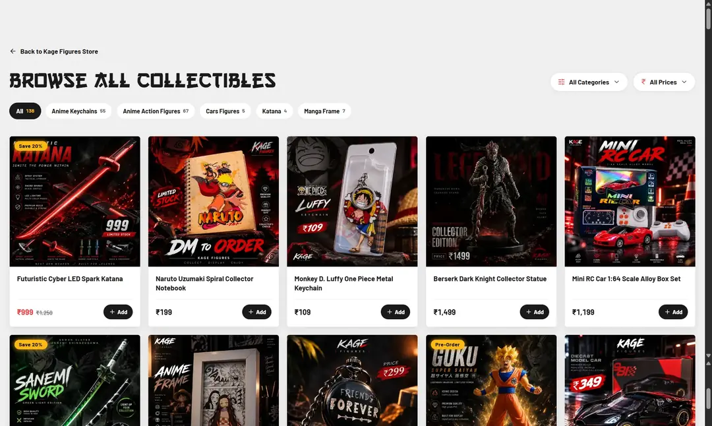
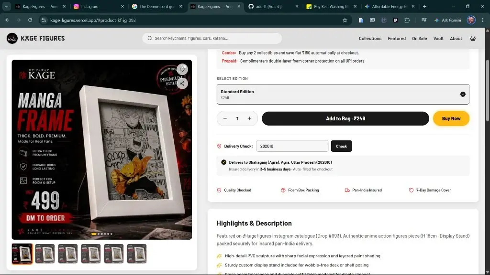
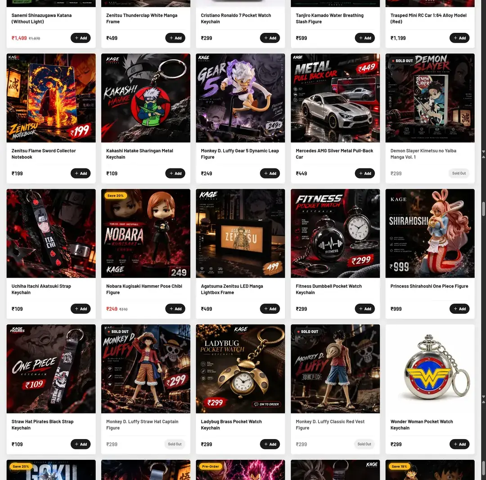
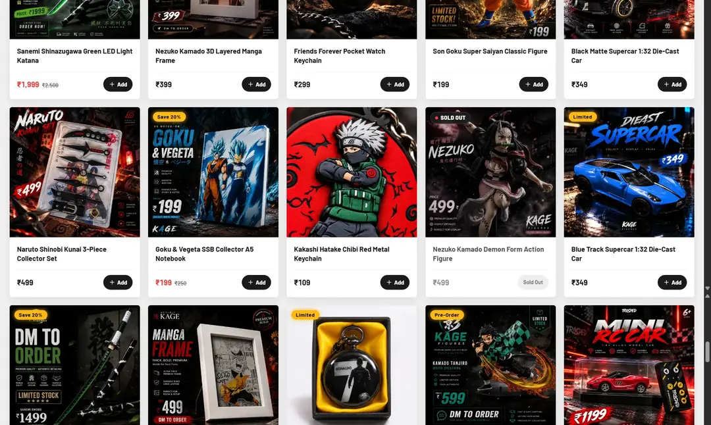

# ⛩️ Kage Figures — Premium Anime Storefront

<div align="center">

[](https://kage-figures.vercel.app/)
[](https://react.dev/)
[](https://www.typescriptlang.org/)
[](https://tailwindcss.com/)
[](https://supabase.com/)

**Curated Anime Keychains, Action Figures, Katana Replicas, Die-Cast Scale Cars & 3D Backlit Manga Frames with Pan-India Delivery.**

[Explore Live Demo](https://kage-figures.vercel.app/) · [Report Bug](https://github.com/adu-ft/Kage-figures/issues) · [Request Feature](https://github.com/adu-ft/Kage-figures/issues)

</div>

---

## 📸 Website Previews

### 1. Storefront & Hero Showcase
The modern dark-themed hero with interactive category filters, live cart drawer, currency switcher, and instant search.



---

### 2. Product Detail & Swipeable Multi-Angle Gallery
Rich product view with touch-swipe multi-angle images, scale/edition selectors, live India pincode delivery checker, and WhatsApp instant order flow.



---

### 3. Curated Product Catalogue Grid
135+ authentic collectibles synced 1:1 with Instagram drops, featuring hover spec previews, live stock badges, dynamic price calculation, and quick-add actions.



---

### 4. Collector Category Collections
Dedicated showcases for Anime Action Figures, Metal Katana Replicas, 1:32 Die-Cast Cars, 3D Manga Frames, and Collector Keychains.



---

## ✨ Key Features

### 🛍️ Storefront & Shopping Experience
* **135+ Curated Collectibles:** Complete catalog mapped 1:1 with authentic drops from the `@kagefigures` archive.
* **Swipeable Multi-Angle Galleries:** Touch-enabled photo carousels on cards and product detail pages, streaming high-res slide photos directly without storing heavy images on disk.
* **Live India Pincode Checker:** Real-time delivery verification with estimated dispatch times (3–5 business days).
* **Multi-Tier Edition Variants:** Standard, Collector, and Deluxe editions with dynamic pricing deltas.
* **Smart Inventory Management:** Automated visual states for active stock and sold-out collector grails.
* **Instant Search & Category Pills:** Real-time client-side search by anime series, character name, studio, or scale.

### 💳 Checkout & Order Processing
* **1-Click WhatsApp Direct Ordering:** Generates clean, pre-filled WhatsApp order messages with itemized breakdowns, customer addresses, and selected payment method (UPI / COD).
* **Automated Discounts & Combos:** Buy-any-2 flat ₹150 automatic discounts and prepaid corner protection perks.
* **Persistent Cart:** LocalStorage-backed cart state with slide-over drawer interface.

### ⚡ Technical Architecture
* **Vercel Serverless Edge Image Proxy:** In-memory streaming proxy (`api/ig-image.ts`) serving multi-slide images with global edge caching (`s-maxage=604800`).
* **Supabase Backend:** Schema-backed order persistence and newsletter subscription collection.
* **Admin Dashboard (`#vault-admin`):** Secure token-authenticated portal to track, inspect, filter, and update customer order dispatch states.

---

## 🛠️ Tech Stack

| Layer | Technologies |
| :--- | :--- |
| **Frontend** | React 19, TypeScript, Vite 8, Motion |
| **Styling** | Tailwind CSS v4, Lucide Icons |
| **Backend & APIs** | Express (Local Dev), Vercel Serverless Functions (Production) |
| **Database & Auth** | Supabase PostgreSQL, JWT-based Admin Tokens |
| **Image Delivery** | Vercel Edge Cache + Reverse Proxy (WebP / AVIF) |
| **Deployment** | Vercel CI/CD |

---

## 📁 Project Structure

```text
kage-figures/
├── api/                        # Vercel Serverless Functions
│   ├── admin/                  # Protected admin routes (orders, subscribers)
│   ├── _lib/                   # Backend Supabase client & utilities
│   ├── ig-image.ts             # In-memory streaming multi-slide image proxy
│   ├── ig-image/[...slug].ts   # Catch-all route for multi-slide images
│   ├── ig-slides.ts            # Slide count & URL extractor
│   ├── orders.ts               # Order submission handler
│   └── health.ts               # Supabase connection diagnostic
├── docs/
│   └── previews/               # Website preview screenshots for documentation
├── public/
│   ├── catalogue/              # Optimized WebP cover photos & brand assets
│   └── fonts/                  # Custom typography (go3v2.woff)
├── src/
│   ├── components/             # React components (ProductCard, Gallery, Drawers)
│   ├── data/                   # Catalog items (135 drops), mappings, slide counts
│   ├── hooks/                  # Custom hooks (lazy loading, in-view triggers)
│   ├── utils/                  # In-memory image cache & formatting helpers
│   ├── App.tsx                 # Core storefront layout & hash routing
│   └── main.tsx                # React entry point
├── server.ts                   # Local Express dev server
├── vercel.json                 # Production API rewrites & edge rules
└── package.json                # Dependencies and scripts
```

---

## 🚀 Getting Started

### Prerequisites
* **Node.js**: v18.0.0 or higher
* **npm** or **bun**

### 1. Clone the repository
```bash
git clone https://github.com/adu-ft/Kage-figures.git
cd Kage-figures
```

### 2. Install dependencies
```bash
npm install
```

### 3. Configure environment variables
Create a `.env.local` file based on `.env.example`:
```bash
cp .env.example .env.local
```

Fill in your configuration:
```env
# Supabase (Optional for local browsing, required for checkout & admin)
SUPABASE_URL=https://your-project-id.supabase.co
SUPABASE_PUBLISHABLE_KEY=your-supabase-anon-key
SUPABASE_SECRET_KEY=your-supabase-service-role-key

# Admin Security
ADMIN_PASSCODE=your_secure_admin_passcode
```

### 4. Run the development server
```bash
npm run dev
```

Visit [http://localhost:3000](http://localhost:3000) in your browser.

---

## 📦 Build for Production

To create an optimized production build:
```bash
npm run build
```

To preview the build locally:
```bash
npm run preview
```

---

## 🌐 Deployment on Vercel

The storefront is configured for zero-config deployment on Vercel:
1. Import the repository on [Vercel](https://vercel.com).
2. Set Framework Preset to **Vite**.
3. Add the environment variables from `.env.local` in **Project Settings → Environment Variables**.
4. Deploy! All API endpoints and client routes are automatically mapped via `vercel.json`.

---

## 📜 License & Credits

* Built for **Kage Figures** — anime collectibles & curated merchandise.
* All figure sculpts and artwork are copyrighted by their respective intellectual property owners (Toei Animation, Shueisha, Bandai, MAPPA, etc.).
